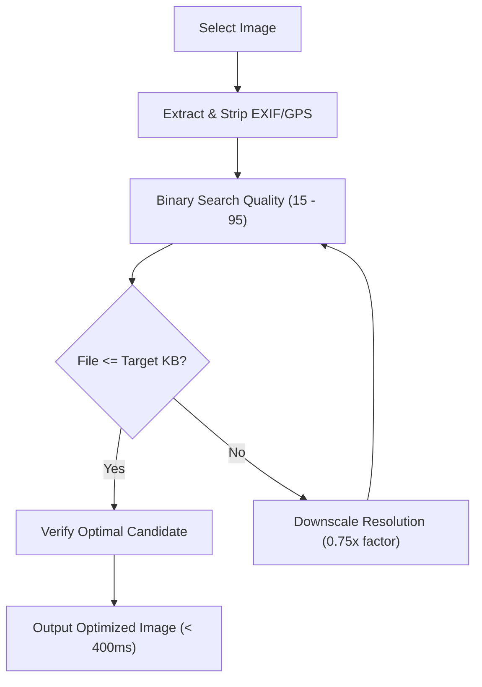

<p align="center">
  
</p>

<h1 align="center">ReSinc</h1>

<p align="center">
  <strong>Offline Android Image Optimizer with strict target size ceilings & EXIF stripping.</strong>
</p>

<p align="center">
  <a href="https://github.com/humayan-x/resinc/actions/workflows/build.yml"></a>
  
  
  
  
  <a href="LICENSE"></a>
</p>

---

## 🚀 Overview

**ReSinc** is a fast, privacy-first, on-device Android image optimization utility built with Flutter. It helps you shrink and downscale photos to strictly guaranteed file sizes (such as `< 100 KB` or `< 500 KB` for portals, emails, or KYC forms) without guesswork.

- **Zero Cloud / 100% On-Device:** Zero internet permissions declared in the Android manifest (`android.permission.INTERNET` is omitted). Photos never leave your hardware.
- **Strict Size Ceilings:** Uses an iterative binary-search compression engine to guarantee files land under target KB limits.
- **Privacy Scrubbing:** Strips sensitive GPS coordinates, device serial numbers, and camera metadata on export.
- **Hardware Accelerated:** Leverages platform-native image decoders for low memory overhead and rapid processing (< 400 ms).

---

## ✨ Features

### 1. 🎛️ Workbench (Tab 1: Home & Compression)
- **Top Bar Branding:** Clean `ReSinc` logo header with Quick Guide and Dark/Light theme toggle.
- **Full-Screen Intake:** Large tap-to-select area with rounded dashed border opens the gallery with a single touch.
- **Image Inspection:** Preview thumbnail with file name, original size, pixel dimensions, and detected EXIF count.
- **Crop Tool:** Integrated aspect-ratio cropping (Freeform, 1:1, 4:3, 16:9) with interactive corner handles.
- **Structured Presets:**
  - 6 standard presets: `Custom KB`, `Max 100 KB`, `Max 200 KB`, `Max 500 KB`, `1080p`, `720p`.
  - Save up to 3 custom KB presets for rapid one-tap re-use.
- **Post-Processing HUD:**
  - Live comparison readout: `Original Size → Optimized Size [-% reduction]`.
  - Resolution metrics and processing duration.
  - Floating action buttons: **Save** to gallery, **Change Presets**, and **Share**.

### 2. 📁 Saved (Tab 2: Processed History)
- **Cumulative Space Saved Counter:** Real-time stats header showing total disk space saved (e.g., `48.5 MB saved`).
- **3-Column Grid:** Clean square image grid with fast offline `.meta` sidecar caching.
- **Automatic Gallery Sync:** Real-time synchronization detecting when an image is deleted from the phone's native Gallery or Google Photos app, automatically purging stale references and cached previews upon app resumption.
- **Detail Modal Dialog:** Fullscreen inspection dialog displaying exact dimensions, file format, savings percentage, creation date, and EXIF status, with one-tap Share, Open in Gallery, and Delete actions.
- **Storage Management:** Single-tap "Clear Saved References" cache cleaner.

### 3. ⚙️ Settings (Tab 3: Preferences & Transparency)
- **Persistent Theme Mode Selector:** Seamless System, Dark (`#202734`), and Light (`#F8FAFC`) modes preserved permanently across app restarts.
- **Guides & Transparency Hub:** Dedicated pages explaining:
  - *How ReSinc Works* (Typographic onboarding walkthrough)
  - *Offline Architecture* (Zero-network security model)
  - *Algorithm Transparency* (Binary-search quality estimation & aspect-ratio scaling)
- **Storage Statistics:** Inspect total saved reference count and disk space reclaimed.
- **Open Source Links:** Direct links to the GitHub repository, issue tracker, and MIT license.

---

## 🎨 Brand & Design System

- **Palette:**
  - Primary Accent: `#5B8C32` (Forest Green)
  - Primary Light: `#7CAE48`
  - Primary Dark: `#426822`
  - Dark Canvas: `#202734`
  - Light Canvas: `#F8FAFC`
- **Branded Native Splash Screen:** Solid green canvas (`#5B8C32`) featuring the centered white ReSinc emblem across all Android versions (including Android 12+ SplashScreen API).
- **Typography:** Google Fonts *Plus Jakarta Sans*.

---

## 🧠 Compression Algorithm

When compressing toward a strict ceiling (e.g. `< 100 KB`):



1. **Iterative Binary Search on Quality:** Probes JPEG quality values between `15` and `95` to find the highest fidelity buffer that satisfies `output_bytes <= target_bytes`.
2. **Resolution Downscaling Fallback:** If high-resolution detail cannot fit at minimum quality, the engine scales dimensions down by `0.75x` steps while maintaining aspect ratio.
3. **Platform Decoders:** Calls native Android platform decoders directly via `flutter_image_compress` for hardware acceleration in native memory.

---

## 🛠️ Project Structure

```
lib/
├── app/
│   ├── app.dart                       # MaterialApp root, theme management & routing
│   └── theme/
│       ├── app_theme.dart             # Dark & light Material 3 ThemeData
│       └── system_ui.dart             # Edge-to-edge transparent system overlay
├── models/
│   ├── compression_options.dart       # Presets, target KB, and resolution options
│   ├── compression_result.dart        # Output metrics, reduction %, time elapsed
│   ├── crop_selection.dart            # Crop rect & aspect ratio models
│   ├── image_metadata.dart            # Extracted EXIF tags, dimensions, GPS data
│   └── saved_item.dart                # Saved item entity & sidecar metadata
├── screens/
│   ├── home_navigation_screen.dart    # Bottom nav coordinator across tabs
│   ├── onboarding/                    # Typographic onboarding walkthrough
│   ├── saved/                         # Tab 2: Saved references & stats
│   ├── settings/                      # Tab 3: Themes, guides, and storage
│   └── workbench/                     # Tab 1: Image intake & compression HUD
├── services/
│   ├── compression_service.dart       # Binary-search compression engine
│   ├── crop_service.dart              # Interactive image cropping
│   ├── exif_service.dart              # Native EXIF/GPS extraction & stripping
│   ├── lanczos_resizer.dart           # Offline software resizer
│   ├── preferences_service.dart       # Offline preferences storage
│   └── saved_service.dart             # Local file persistence & gallery export
├── utils/
│   ├── constants.dart                 # App constants, palette, asset paths
│   └── file_utils.dart                # Byte formatting & safe disk helpers
└── widgets/
    ├── floating_bar_frame.dart        # Frosted glass floating frame
    ├── floating_bottom_bar.dart       # 3-item navigation pill bar
    └── workbench_action_bar.dart      # Dual-mode action bar (Nav / Compress)
```

---

## 📲 Building & Running

### Prerequisites
- [Flutter SDK](https://docs.flutter.dev/get-started/install) (3.13+)
- Android SDK (API 24+ min, API 34+ target)
- Java 17

### Local Development
```bash
# Clone the repository
git clone https://github.com/humayan-x/resinc.git
cd resinc

# Install dependencies
flutter pub get

# Run test suite
flutter test

# Run on a connected Android device
flutter run
```

### Build Optimized Release APKs Locally

ReSinc uses R8 code/resource shrinking, native library DEFLATE compression, and Dart symbol stripping to produce ultralightweight release APKs:

```bash
# Build ABI-split, obfuscated release APKs with externalized debug symbols & clean stripping
flutter build apk --release --split-per-abi --obfuscate --split-debug-info=./symbols --extra-gen-snapshot-options=--strip
```

The optimized split APKs are output to `build/app/outputs/flutter-apk/`:
- `app-arm64-v8a-release.apk` (~**8.3 MB**, 54% reduction from default 18.5 MB)
- `app-armeabi-v7a-release.apk` (~**7.8 MB**)
- `app-x86_64-release.apk` (~**8.5 MB**)

Debug symbols are saved to `./symbols` for stack trace de-obfuscation (`flutter symbolize`).

---

## 🤖 Continuous Integration & Automated Builds

ReSinc includes an automated [GitHub Actions Workflow](.github/workflows/build.yml) that triggers on every push and pull request to `main`:

1. **Lint & Test:** Runs `flutter analyze` and `flutter test --coverage`.
2. **Build Optimized APKs:** Builds lightweight ABI-split release APKs with R8 shrinking, native `.so` compression, and symbol obfuscation (`--split-per-abi --obfuscate --split-debug-info=./symbols`).
3. **Automated Size Audit:** Summarizes artifact file sizes in the GitHub Actions step summary table.
4. **Artifact Upload:** Generated split APKs and debug symbols are automatically archived and downloadable directly from the GitHub Actions run summary or tagged releases.

---

## 🤝 Contributing

Contributions, bug reports, and suggestions are welcome! Please read [CONTRIBUTING.md](CONTRIBUTING.md) and our [CODE_OF_CONDUCT.md](CODE_OF_CONDUCT.md) before submitting a pull request.

---

## 🔒 Security & Privacy

For vulnerability reporting and details on our privacy guarantees, see [SECURITY.md](SECURITY.md).

---

## 📄 License

This project is licensed under the [MIT License](LICENSE).
